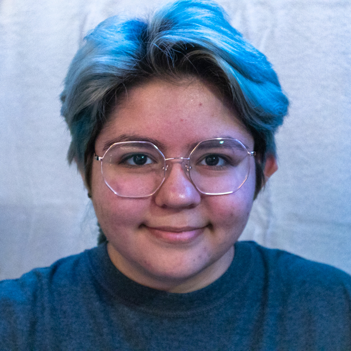

{: width="250" }

# Artist Bio 
Emerson Buczek is a Twin Cities metro based visual artist focused in 2D media with an interest in technology. He graduated from St Olaf College with a Bachelors of Arts in Studio Art and Computer Science. He uses photography, image editing software, and painting to create works about identity and expression.

Emerson has been featured at two different student exhibitions for his artwork. Austin Community College in 2023 with a self portrait, and at St Olaf College Jury Show in 2026. He worked as a Flaten Art Museum Attendant and as the president of St Olaf’s Photography Club. Emerson is working towards how to combine his interest in computers with his art. Currently he is exploring 3D media. His long-term goal is to find the medium that best fits to merge his love for coding with art.

# Artist Statement
I use identity, morals, and illusions to explore the current experience of technology through my artwork. I care deeply about how people are impacted by social engineering to view their time, resources, their community, and themselves. I appreciate the enjoyment and connection online technologies created, to connect with distant friends, but also worry about how it impacts peoples’ psyche and perception of the world.

I like to use physical mediums such as painting, cyanotype, pastels, and film photography to contradict the nature of technology and the digital world. I use contrasting hues to make the viewer's eye wander around the artwork, sometimes with monochrome sections next to bold colors. On the other side, I also explore nature with digital photography to collage the physical world together. I show how people view the world through digital cameras by manipulating work with computer software.

Going forward, I would like to focus on more physical artwork, as artificially generated visual elements become more and more common. By having something physically tangible, I can disconnect from the presumption something was made without human creativity.